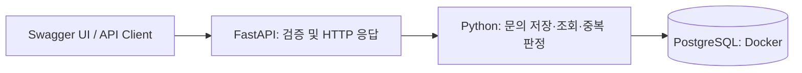

# 고객문의 업무 자동화 시스템

기업의 고객문의 접수부터 정책 확인, 처리, 승인, 결과 기록까지 자동화하는 AX 포트폴리오 프로젝트입니다. Python 학습과 함께 단계별로 구현합니다.

## 해결하려는 업무 문제

담당자가 문의를 읽고 주문 정보와 정책을 각각 확인한 뒤 답변과 처리 이력을 작성하는 반복 업무를 대상으로 합니다. 중복 접수와 처리 누락을 방지하고, 승인 과정과 실행 이력을 추적하는 것이 목표입니다. 실제 기업에 배포한 서비스나 측정된 업무 효율 수치는 아직 없습니다.

## 수동 프로세스와 목표 프로세스

- 수동: 문의 확인 → 유형 판단 → 주문·정책 조회 → 직원 판단 → 답변 → 이력 기록
- 목표: 접수 → LLM 분류·정보 추출 → RAG 정책 검색·주문 API 조회 → 코드로 조건 검증 → 답변 초안 → 필요 시 사람 승인 → 처리·이력 저장·알림

현재 구현 범위는 **Phase 1: 문의 등록·조회 및 PostgreSQL 저장**입니다. LLM, RAG, n8n, 승인, 알림은 후속 단계입니다.

## Architecture

현재 실행 구조:



목표 구조와 책임 분리는 [설계 문서](docs/superpowers/specs/2026-10-01-customer-inquiry-automation-design.md)에 정리했습니다.

## 기술 선택 이유

| 기술 | 역할과 선택 이유 |
|---|---|
| Python / FastAPI / Pydantic | 자동화 코드를 API로 제공하고 입력·응답 형식을 검증 |
| PostgreSQL / SQLAlchemy | 문의 영속 저장, 트랜잭션, 고유 제약을 통한 중복 방지 |
| Alembic | DB 스키마 변경 이력 관리 |
| Docker Compose | 개발 DB를 동일한 설정으로 실행 |
| pytest / TestClient | 실제 PostgreSQL 테스트 DB에서 API 동작과 저장 결과 확인 |

## 주요 Workflow와 예외 처리

문의 등록: 요청 검증 → 기존 키 확인 → 고객 존재 확인 → 트랜잭션 저장 → 응답.

| 상황 | 결과 |
|---|---|
| 최초 등록 | `201`, `RECEIVED` |
| 동일 키·동일 고객·동일 본문 | `200`, 기존 문의 반환 |
| 동일 키·다른 내용 | `409`, 기존 문의 유지 |
| 없는 고객 또는 문의 | `404` |
| 잘못된 UUID, 빈 본문, 잘못된 키 | `422` |
| 동시에 같은 키로 등록 | DB 고유 제약 충돌 후 rollback·기존 문의 재조회 |
| DB 연결 실패 | 성공 응답으로 숨기지 않음; 운영용 오류 응답·재시도 정책은 후속 단계 |

현재 키는 전체 문의에서 고유합니다. 인증과 고객별 접근 제어는 아직 구현되지 않았으며, 가상 데이터를 사용하는 로컬 데모 범위입니다.

## 구현 범위와 학습 기록

현재 구현: 요청·응답 스키마, 라우터와 서비스 분리, SQLAlchemy 모델, 마이그레이션, 데모 고객 seed, 중복 처리, PostgreSQL 통합 테스트.

AI 도구의 지원을 받아 구현하고, 각 단계의 코드를 학습한 뒤 직접 실행 결과를 확인합니다. 개인 기여와 설계 결정은 개발하면서 추가로 기록합니다.

## 시행착오

- 다른 노트북의 Docker를 사용하면 네트워크와 실행 환경을 함께 관리해야 하므로 현재 PC에 개발 DB를 구성했습니다.
- Docker CLI에서 인증 보조 프로그램을 찾지 못한 문제는 Docker 실행 파일 경로를 실행 프로세스의 PATH에 추가해 해결했습니다.
- Swagger에서 정상적인 `200`·`409` 응답이 `Undocumented`로 표시되어 응답 설명을 명시했습니다.

## 실행 방법

필요 환경: Python 3.11 이상, 실행 중인 Docker Desktop, PowerShell. 프로젝트 폴더에서 실행합니다.

```powershell
python -m venv .venv
.\.venv\Scripts\python.exe -m pip install -e '.[dev]'
if (-not (Test-Path -LiteralPath '.env')) { Copy-Item .env.example .env }
```

`.env`의 비밀번호를 임의의 URL-safe 값으로 바꾸고 두 DB URL에 동일하게 반영합니다. 개발 DB는 `inquiries`, 테스트 DB는 `inquiries_test`를 사용합니다. `.env`는 Git에서 제외됩니다. 기존 환경에 `.env`가 있으면 덮어쓰지 마세요.

```powershell
docker compose up -d db
Get-Content -LiteralPath '.env' | ForEach-Object {
    if ($_ -and -not $_.StartsWith('#')) {
        $entry = $_ -split '=', 2
        [Environment]::SetEnvironmentVariable($entry[0], $entry[1], 'Process')
    }
}
.\.venv\Scripts\python.exe -m alembic upgrade head
.\.venv\Scripts\python.exe -m scripts.seed_demo
.\.venv\Scripts\python.exe -m uvicorn app.main:app --reload --env-file .env
```

DB가 준비되기 전에 마이그레이션이 실패하면 `docker compose ps`에서 healthy 상태를 확인한 후 다시 실행합니다. 테스트 DB 생성 SQL은 새 DB 볼륨의 첫 초기화 때 실행됩니다.

API 문서: <http://127.0.0.1:8000/docs>. 서버는 `Ctrl+C`로 종료합니다.

## Demo

Swagger의 `POST /inquiries`에 다음 JSON을 입력합니다.

```json
{
  "customer_id": "00000000-0000-0000-0000-000000000001",
  "body": "주문한 상품의 배송 상태를 알고 싶습니다.",
  "idempotency_key": "manual-test-001"
}
```

첫 요청은 `201`, 동일 요청 반복은 `200`과 동일 ID, 본문만 변경하면 `409`입니다. 반환된 ID로 `GET /inquiries/{inquiry_id}`를 호출하면 저장된 문의를 확인할 수 있습니다. 서버를 종료·재시작한 뒤 같은 ID로 조회하여 영속 저장을 검증합니다. 영상·GIF는 추후 추가합니다.

## 테스트

위 환경 변수를 불러온 별도 PowerShell에서 실행합니다.

```powershell
.\.venv\Scripts\python.exe -m pytest -q
```

테스트는 별도 PostgreSQL DB를 사용하고 테스트에서 생성한 고객·문의만 정리합니다. 정상 등록, 입력 오류, 중복·동시 요청, 조회, 마이그레이션과 연결 실패를 검증합니다.

## 향후 개선사항

LLM 구조화 출력 → 정책 RAG → n8n orchestration → 사람 승인 → 재시도·timeout·실행 이력 → 전체 Docker 실행환경 → 데모와 개인 기여 문서 순서로 확장합니다. LLM은 분류·추출·초안을 담당하고, 금액·승인·실행 조건은 일반 코드로 검증할 계획입니다. Playwright 기반 레거시 연동은 실제 필요가 생긴 뒤 검토합니다.
