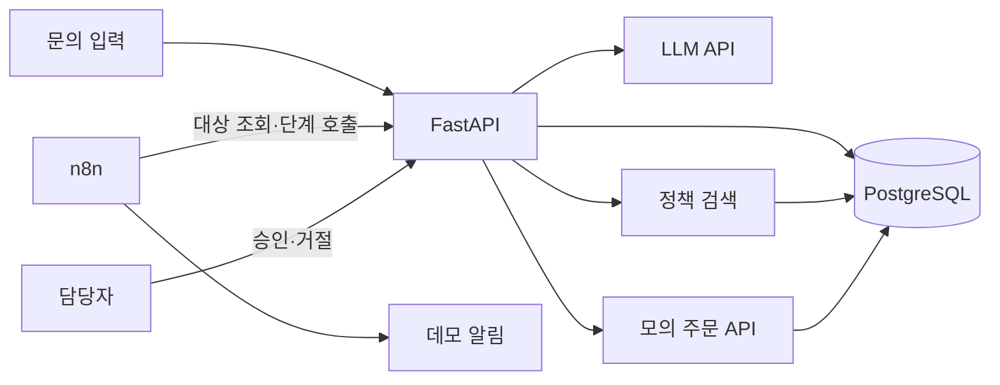

# 고객문의 자동 처리 시스템 설계

## 목적과 성공 기준

이 프로젝트는 AX·업무자동화 개발자 포트폴리오를 위한 개인 프로젝트다. 고객 문의를 접수한 뒤 주문 데이터와 사내 정책을 근거로 처리 방향을 결정하고, 필요한 경우 직원 승인을 거쳐 결과와 실행 이력을 남기는 업무 자동화 시스템을 만든다. 구현 과정은 Python 학습을 병행할 수 있도록 작은 기능 단위로 진행한다.

성공 기준은 하나의 문의 ID를 통해 접수 내용, 구조화 결과, 조회한 주문과 정책, 판단 근거, 승인 여부, 최종 결과, 오류와 재시도 이력을 추적할 수 있는 것이다. README와 데모에서는 수동 프로세스와 자동화 후 프로세스, 직접 구현한 부분, 검증한 실패 사례를 보여준다. 측정하지 않은 효율 수치는 사용하지 않는다.

## 범위

대표 업무는 배송 문의의 자동 처리와 환불 문의의 직원 승인이다. 정보가 부족하거나 정책 근거를 찾지 못한 문의는 자동 완료하지 않고 검토 대상으로 전환한다. 초기 주문·고객 데이터와 주문 조회 API는 프로젝트 내부의 모의 데이터와 API로 제공한다. 실제 환불 실행과 고객 메시지 발송은 MVP에 포함하지 않는다. 처리 결과는 DB에 저장하고 데모 알림 채널로 알린다.

OCR·Playwright 기반 레거시 자동화는 대표 프로젝트 완료 뒤 별도 확장 프로젝트로 다룬다.

## 전체 구조와 책임

FastAPI는 API 입력 검증, DB 상태 변경, LLM 결과 검증, 정책 검색, 주문 조회, 업무 규칙과 실행 기록을 소유한다. n8n은 처리 대상 조회, 단계 호출 순서, 승인 대기와 알림을 조정한다. n8n은 DB를 직접 변경하지 않는다. 초기 연동은 n8n의 주기적 대상 조회 방식으로 시작한다. 처리 대상은 API를 통해 원자적으로 점유해 같은 문의가 동시에 처리되지 않게 한다.

LLM은 문의 유형 분류, 본문에서 정보 추출, 확인된 자료에 기반한 답변 초안을 담당한다. 주문번호 유효성, 주문 소유 관계, 환불 조건, 승인 필요 여부, 상태 전이는 일반 코드가 담당한다. LLM 출력은 스키마 검증을 통과해야 하며, 검증 실패는 자동 완료로 이어지지 않는다.

## 데이터 흐름

1. `POST /inquiries`가 문의와 중복 방지 키를 받아 `RECEIVED`로 저장한다.
2. n8n이 처리 대상을 조회하고 `claim` API를 호출한다. 성공하면 문의는 `PROCESSING`이 되고 `workflow_runs`에 새 실행이 기록된다.
3. FastAPI가 LLM 결과를 검증하고 주문번호를 추출한다. 필요한 주문 정보를 모의 API로 조회한다.
4. 정책 문서에서 관련 구간을 검색한다. 검색된 문서 ID와 구간을 실행 결과에 연결한다.
5. 일반 코드가 정책과 주문 데이터에 따라 처리 방향과 승인 필요 여부를 결정한다. LLM은 확인된 근거만 사용해 답변 초안을 만든다.
6. 일반 문의는 `COMPLETED`가 된다. 환불·고액·민감 문의는 `WAITING_APPROVAL`이 된다. 승인 또는 거절 결과를 저장한 뒤 흐름을 재개한다.
7. 결과와 단계별 로그를 DB에 저장하고 데모 알림을 보낸다.

정책 검색 결과가 없거나 필요한 주문 정보를 확인하지 못하면 자동 답변을 완료하지 않고 담당자 검토로 보낸다. 승인 대기 시간이 초과되면 승인 항목과 문의 상태에 사유를 기록하고 담당자에게 알린다. 승인 대기와 최종 실패는 별개의 상태와 사유로 구분한다.

## 데이터 모델 초안

| 테이블 | 주요 필드와 제약 | 역할 |
|---|---|---|
| `customers` | ID, 데모용 식별 정보 | 고객 소유 관계 |
| `orders` | 주문번호 고유, 고객 ID, 금액, 상태, 주문일 | 모의 주문 조회 |
| `inquiries` | ID, 고객 ID, 본문, 상태, 답변, 중복 방지 키 고유, 시각 | 문의의 현재 상태 |
| `documents` | ID, 제목, 버전, 활성 여부 | 정책 원본 |
| `policy_chunks` | 문서 ID, 구간 본문, 분류·키워드 | 검색 가능한 정책 단위 |
| `workflow_runs` | ID, 문의 ID, 시작·종료, 상태, 실패 단계 | 실행과 재실행 이력 |
| `approvals` | 문의 ID, 요청 사유, 상태, 요청·만료·결정 시각, 담당자 | 승인 이력 |
| `automation_logs` | 실행 ID, 단계, 결과, 오류 코드, 시각 | 장애 조사 |

문의 상태는 `RECEIVED`, `PROCESSING`, `WAITING_APPROVAL`, `COMPLETED`, `FAILED`로 시작한다. 실행 이력 상태는 문의의 현재 상태와 별도로 관리한다. 승인 상태는 `PENDING`, `APPROVED`, `REJECTED`, `EXPIRED`로 관리한다. 상태 변경은 허용된 전이만 수용한다.

## API 초안

| API | 역할 | 도입 단계 |
|---|---|---|
| `POST /inquiries` | 문의 등록과 중복 방지 | 1, 6에서 강화 |
| `GET /inquiries/{id}` | 현재 상태·결과 조회 | 1 |
| `GET /inquiries/{id}/runs` | 실행 이력 조회 | 4 |
| `POST /admin/documents` | 정책 문서 등록 | 3 |
| `GET /internal/inquiries/ready` | 처리 대상 조회 | 4 |
| `POST /internal/inquiries/{id}/claim` | 원자적 처리 점유 | 4 |
| `POST /internal/inquiries/{id}/analyze` | 분류·추출·조회·검색·초안 | 4 |
| `POST /internal/inquiries/{id}/finalize` | 업무 규칙에 따른 상태 확정 | 4 |
| `GET /approvals?status=pending` | 승인 대기 조회 | 5 |
| `POST /approvals/{id}/decision` | 승인·거절 기록 | 5 |

`/internal`과 `/admin`은 데모에서도 인증한다. API 형태는 각 단계 구현 직전에 필요한 범위에서 구체화한다. Phase 1에서는 문의 등록·조회만 구현한다.

## 정책 검색과 답변 근거

초기에는 소수의 데모 정책을 구간으로 나누고 분류·키워드 기반 검색을 사용한다. 검색 구간을 LLM 입력에 포함하고, 답변을 생성할 때 참조한 정책 ID와 버전을 저장한다. 대표 질문으로 검색 결과를 확인한다. 한국어 검색 품질이 부족하다는 결과가 확인되면 임베딩 및 pgvector 도입을 검토한다. 검색 근거가 없으면 LLM이 정책을 추측해 답하지 않도록 한다.

## 실패 처리와 검증

LLM 응답의 파싱·스키마 검증 실패, LLM 호출 실패, 주문 API timeout, 중복 문의·중복 실행, 정책 검색 결과 없음, 승인 대기 timeout, 일부 단계 실패를 검증한다. 일시적 네트워크 실패만 제한된 횟수로 재시도한다. 각 시도는 실행 ID와 단계 이름을 포함해 기록한다. 같은 중복 방지 키의 접수와 같은 문의의 동시 점유는 DB 제약·트랜잭션으로 막는다. 실패 시 최종 문의 상태와 실패 단계가 조회 가능해야 한다. Playwright 실패는 확장 프로젝트에서 다룬다.

## 단계별 구현과 학습 방식

| Phase | 작업 | 대략적 개인 작업 시간 |
|---|---|---:|
| 1 | FastAPI, PostgreSQL, 문의 등록·조회 | 14~24시간 |
| 2 | LLM 분류·추출·검증 | 10~18시간 |
| 3 | 정책 등록·검색·근거 기반 초안 | 12~22시간 |
| 4 | n8n 처리 흐름과 실행 기록 | 10~18시간 |
| 5 | 승인·거절·재개 | 12~22시간 |
| 6 | 재시도·timeout·중복·장애 복구 검증 | 14~26시간 |
| 7 | Docker Compose 실행 환경 | 8~14시간 |
| 8 | README·구조도·데모·시행착오 | 12~22시간 |

기간은 고정하지 않는다. 각 기능마다 목적 설명, 필요한 Python 개념과 가능한 C# 대응 개념, 최소 동작 코드, 실행 방법, 사용자 직접 테스트, 오류 분석, 동작 확인 순서로 진행한다. 오류 처리는 각 Phase에서 기본 수준으로 포함하고 Phase 6에서 전체 흐름의 안정성을 점검한다.

## 포트폴리오 산출물과 제외 범위

README에는 업무 문제, 기존 수동 절차, 자동화 후 절차, Architecture, 기술 선택 이유, 주요 Workflow, 예외 처리, 직접 구현한 부분, 시행착오, 실행 방법, Demo, 향후 개선사항을 포함한다. 데모는 자동 완료·승인·실패 사례를 보여준다. 실제 측정 전에는 효율 개선 수치를 기재하지 않는다.

MVP에서는 OCR, Playwright, 실제 환불·결제 실행, 운영 수준 관리자 UI, 다중 LLM 제공자 지원, 별도 벡터 DB를 제외한다. 필요성이 확인되면 대표 프로젝트 완성 후 추가한다.
